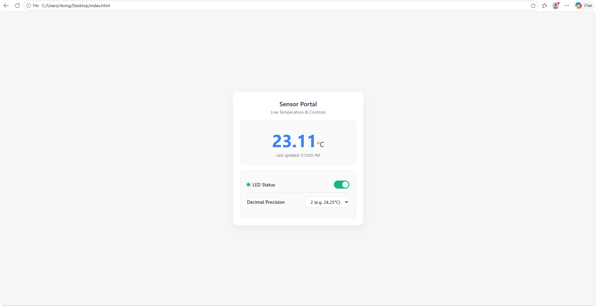

## Introduction
In this lab, we used designed and built a simple IoT device with a focus on implementing the SPI functionality from the MCU. The MCU was interfaced with the temperature sensor module over an SPI link and an ESP8266 module over a UART link. It also connects to a simple HTML page to control and display the data from the peripherals connect to the MCU. The user can adjust the resolution as well as switching an onboard LED on and off through the HTML page. 

## Design and Testing Methodology
This lab has three main components: creating the HTML webpage using the MCU, transmitting the web page to a PC over the ESP8266, and setting up the communication between the MCU and the DS1722. The MCU interfaces with both the ESP8266 for the wifi module and the DS1722 digital temperature sensor. The user is able to interact with the HTML page to switch the LED and change the resolution. This information is then sent back via WiFi to the ESP8266 and then the MCU through UART. The MCU then adjusts the LED based on the user input and sends the resolution change request to the DS1722. The MCU also reads the temperature from the DS1722 upon every request, which it then sends back to the web page with the updated temperature values.

### HTML Page
The HTML page provides an interface for a user to interact with the system. There are buttons to adjust the resolution of the temperature readings as well as toggle the LED state. The webpage will then display the temperature data read from the temperature sensor alongside the resolution and LED state.

### ESP8266 to MCU Interface
The MCU must supply the web page to the ESP8266. It does so over a UART connection where the receive and transmit lines are crossed so that while the MCU transmits data the ESP8266 is receiving it and vice versa. 

The devices interface through a 125000 baud serial UART connection on the MCU and the UART TX and RX lines of the ESP8266. To ensure both devices use the same bit timing, the UART baud rate is set to 125000 on both the MCU and the ESP8266.

### Digital Temperature Sensor
The digital temperature sensor and the MCU interface over SPI. For the MCU, the SPI was configured for full-duplex communication to allow communication between the temperature sensor and the MCU to occur both ways as well as aligning with the pin layout of the DS1722. Full-duplex allows sending and reading data simultaneously, as opposed to half-duplex which is bidirectional, making it so that only sending or reading can occur at once and simplex which simply only communicates in one direction. 

Because this setup allows reading and writing of data simultaneously, when the MCU writes the resolution bits to the temperature sensor, it receives meaningless junk data in return--which is not utilized. The same thing occurs for the temperature information exchange, where the MCU reads the most recently completed temperature measurement and sends junk data that the temperature sensor does not use.

The temeperature sensor requires the CPHA must be set to 1 while operating in SPI mode. I then set CPOL to 0 which samples on the falling edge of each clock pulse. The baud rate is set to 5 (0b101) to get a clock rate of 1.25MHz as the maximum clock rate that the DS1722 can handle is 5MHz.

Figure 1: Calculations to solve for motor speed.

Figure 2: Calculations to solve for motor speed.

## Technical Documentation
The source code for the project can be found in the associated [GitHub repository](https://github.com/rlxkong/E155-Lab6).

### Schematic

Figure 3 shows the schematic of the temperature sensor MCU circuit.

## Results and Discussion
The design accomplished all of the design objectives. A majority of the lab was spent scanning through the datasheets before being able to implement the functionality into software. 

## Conclusion
The design successfully output the speed and direction of the motor. This lab took me around 12 hours.

## AI Prototype Summary

::: {.callout-note collapse="true"}
## AI Generated Code for HTML Page
<!DOCTYPE html>
<html lang="en">
<head>
    <meta charset="UTF-8">
    <meta name="viewport" content="width=device-width, initial-scale=1.0">
    <title>Temperature Sensor Portal</title>
    
</head>
<body>

    

        <h1>Sensor Portal</h1>
        
Live Temperature & Controls

    

    <!-- Temperature Card -->
    

        

            --°C
        

        
Updating...

    

    <!-- Controls Card -->
    

        <!-- LED Control -->
        

            

                
                LED Status
            

            <label class="switch">
                <input type="checkbox" id="ledToggle" onchange="toggleLED(this.checked)">
                
            </label>
        

        <!-- Precision Control -->
        

            Decimal Precision
            <select id="precisionSelect" onchange="updatePrecision(this.value)">
                <option value="0">0 (e.g. 24°C)</option>
                <option value="1" selected>1 (e.g. 24.2°C)</option>
                <option value="2">2 (e.g. 24.25°C)</option>
            </select>
        

    

</body>
</html>
:::

The interface for the AI generated webpage looks a lot nicer than the one I created and it took them a significantly shorter amount of time. This was generating random values by the AI, however, it wouldn't be that difficult to integrate into my current code--espeically if I were to give the AI the context of the rest of the code, it would be a great tool to use and quickly generate an interactive website.

::: {.callout-note collapse="true"}
## AI Generated SPI Transaction Code
#include "stm32l4xx_hal.h"

// Define the Chip Select (CS) port and pin (adjust to your schematic, e.g., PA4)
#define DS1722_CS_PORT    GPIOA
#define DS1722_CS_PIN     GPIO_PIN_4

/**
 * @brief  Retrieves the temperature reading from a DS1722 sensor via SPI.
 * @param  hspi: Pointer to the SPI_HandleTypeDef structure (e.g., &hspi1).
 * @return Temperature in degrees Celsius as a float. Returns -999.0f on error.
 */
float DS1722_ReadTemperature(SPI_HandleTypeDef *hspi) {
    uint8_t txData = 0x01;       // Address 01h (LSB) with MSb (A7) = 0 for a Read operation
    uint8_t rxData[2] = {0};     // rxData[0] = LSB, rxData[1] = MSB
    int16_t rawTemp = 0;

    // 1. Assert Chip Select (Drive LOW to select DS1722)
    HAL_GPIO_WritePin(DS1722_CS_PORT, DS1722_CS_PIN, GPIO_PIN_RESET);

    // 2. Transmit the read register address (0x01)
    if (HAL_SPI_Transmit(hspi, &txData, 1, HAL_MAX_DELAY) != HAL_OK) {
        HAL_GPIO_WritePin(DS1722_CS_PORT, DS1722_CS_PIN, GPIO_PIN_SET); // De-assert CS on error
        return -999.0f; // Error indicator
    }

    // 3. Receive 2 bytes via burst read (LSB at 0x01, auto-increments to MSB at 0x02)
    if (HAL_SPI_Receive(hspi, rxData, 2, HAL_MAX_DELAY) != HAL_OK) {
        HAL_GPIO_WritePin(DS1722_CS_PORT, DS1722_CS_PIN, GPIO_PIN_SET); // De-assert CS on error
        return -999.0f; // Error indicator
    }

    // 4. De-assert Chip Select (Drive HIGH to end transaction)
    HAL_GPIO_WritePin(DS1722_CS_PORT, DS1722_CS_PIN, GPIO_PIN_SET);

    // 5. Combine LSB and MSB into a 16-bit signed integer (Two's complement format)
    rawTemp = (int16_t)((rxData[1] << 8) | rxData[0]);

    // 6. Scale for resolution 
    // Assuming default 12-bit resolution mode (1 LSB = 0.0625°C), 
    // shifting right by 4 aligns the bits correctly.
    rawTemp = rawTemp >> 4;

    // Convert to actual Celsius value
    float temperature = (float)rawTemp * 0.0625f;

    return temperature;
}
:::

